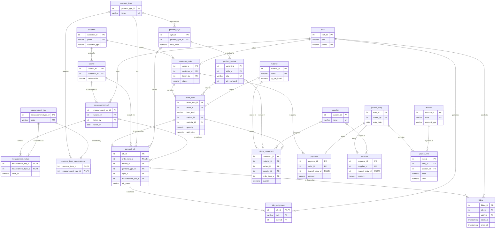

# ER diagram — Deeva's Designs

GitHub renders the diagram below directly. Only key columns are shown; the full column list is in [01_schema.sql](01_schema.sql).

## Reading the notation

| Symbol | Meaning |
|---|---|
| `||` | Exactly one |
| `o|` | Zero or one |
| `o{` | Zero or many |
| `|{` | One or many |

For example, `customer ||--o{ wearer` means each wearer belongs to exactly one customer, while a customer can have zero or many wearers.

## Reading the notation

| Symbol | Meaning |
|---|---|
| `\|\|` | exactly one |
| `\|o` | zero or one |
| `o{` | zero or many |
| `\|{` | one or many |

For example, `customer ||--o{ wearer` reads: each wearer belongs to exactly one customer, and a customer has zero or many wearers.
